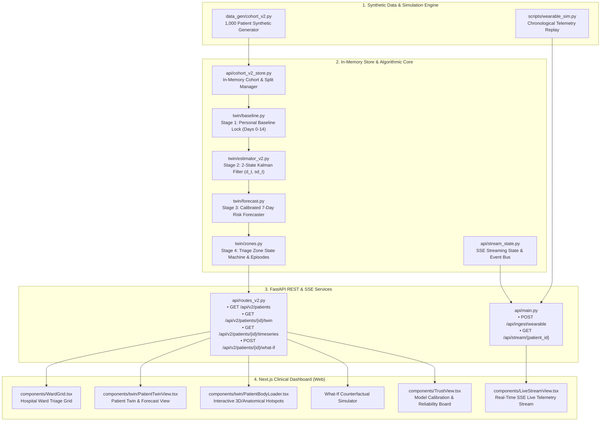
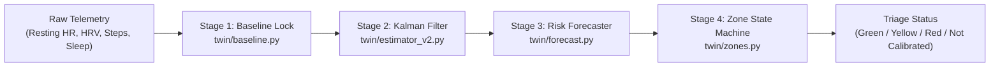

# PulseTwin: Complete System Architecture, Prediction Model & Feature Catalog

This document provides a comprehensive technical reference for the **PulseTwin (Heart Recovery Digital Twin)** platform. It details the end-to-end data flow, full technology stack, mathematical formulation of the 4-stage prediction model, and a catalog of all features implemented across the application.

---

## 1. High-Level Purpose & Operating Constraints

**PulseTwin** is a clinical decision-support platform designed for post-myocardial infarction (post-MI) remote monitoring. It continuously aggregates wearable telemetry and behavioral data, tracks physiological recovery relative to a patient's personal baseline, forecasts 7-day urgent readmission risks, and triages patients into clinical risk zones.

### Core Operating Constraints
1. **Synthetic Data Only**: 100% synthetic cohort data (no Protected Health Information / PHI or real patient identifiers).
2. **Decision Support Only**: Provides risk stratification, trajectory estimations, and triage prioritization. It **never** provides direct medication dosing, treatment directives, or clinical diagnosis.
3. **Strict Causal Discipline (Zero Future Leakage)**: Any computation evaluated as of recovery day $t$ (`as_of_day`) strictly accesses observations up to day $t$. Future observations or post-discharge outcomes are completely forbidden.
4. **Pure-NumPy ML Architecture**: The estimation and forecasting engines are implemented entirely in pure NumPy without third-party ML frameworks (no scikit-learn, PyTorch, or pandas).

---

## 2. Complete Technology Stack

| Layer | Technologies & Tools | Rationale & Usage |
| :--- | :--- | :--- |
| **Backend Core** | Python 3.11, FastAPI, Pydantic v2, Uvicorn | High-performance asynchronous REST API, rigorous request/response data contracts, and OpenAPI documentation. |
| **State Estimation & ML** | Pure NumPy (`numpy>=1.26.0`) | 2-State Kalman Filter, Newton-Raphson $L_2$-logistic regression solver, Platt scaling calibration engine. Pure, auditable, and dependency-free. |
| **Real-Time Streaming** | Server-Sent Events (SSE), Python `asyncio`, Uvicorn | Real-time continuous telemetry ingestion (`POST /api/ingest/wearable`) and streaming client updates (`GET /api/stream/{patient_id}`). |
| **Frontend Framework** | Next.js 15 (App Router), React 19, TypeScript | Server and client component rendering, static type safety, and fast client-side transitions. |
| **Styling & UI Design** | Vanilla Tailwind CSS v3, Lucide React Icons | Modern clinical dark/light interface, accessible color palettes, micro-animations, and responsive layouts (desktop, tablet, mobile). |
| **Data Visualization** | HTML5 Canvas, SVG, Custom Sparklines | Interactive timeseries charts with normal bands, missing-data gap handling, and 7-day risk forecast cones ($P_{10}, P_{50}, P_{90}$). |
| **Automated Testing** | Pytest, Node Test Runner (`node --test`) | 18 automated test suites covering leakage tests, mathematical invariant checks, API regression, and UI component tests. |
| **Validation & Audit** | Headless Chrome/Edge Automation scripts | Automated screenshot evidence generation, calibration audit curves, and benchmark verification scripts. |

---

## 3. End-to-End System Flow & Architecture



---

## 4. Full Prediction Model Working & Mathematical Foundations

The prediction architecture consists of four tightly-coupled, causally-ordered stages:



### Stage 1: Personal Baseline Calibration Guard
* **File Reference**: [twin/baseline.py](file:///c:/Users/Public/heartdisease/twin/baseline.py)
* **Problem**: Normal resting heart rates vary significantly across post-MI patients ($55\text{--}82\text{ bpm}$). Static, one-size-fits-all population thresholds trigger high false-alarm rates.
* **Mechanism**:
  1. Searches chronologically over post-discharge days $0 \le t \le 14$ for the **first 3 valid resting HR readings**.
  2. Once 3 readings are observed, locks the patient's personalized baselines:
     $$\text{HR}_0 = \frac{1}{3}\sum \text{HR}, \quad \text{HRV}_0 = \frac{1}{3}\sum \text{HRV}, \quad \text{steps}_0 = \frac{1}{3}\sum \text{steps}, \quad \text{sleep}_0 = \frac{1}{3}\sum \text{sleep}$$
  3. Computes the individual **Normal Band**:
     $$\text{Normal Band} = \left[\text{HR}_0 - 1.96 \cdot \sigma_{\text{HR}}, \quad \text{HR}_0 + 1.96 \cdot \sigma_{\text{HR}}\right]$$
     with a clinical variance floor $\sigma_{\text{HR}} \ge 2.0\text{ bpm}$.
  4. **Calibration Guard**: If fewer than 3 valid readings exist by Day 14, the patient status remains `"Not calibrated"`. All state estimates and risk scores are withheld rather than falling back to an unverified default.

---

### Stage 2: Causal State-Space Estimator (2-State Kalman Filter)
* **File Reference**: [twin/estimator_v2.py](file:///c:/Users/Public/heartdisease/twin/estimator_v2.py) and [twin/estimator.py](file:///c:/Users/Public/heartdisease/twin/estimator.py)
* **Problem**: Wearable telemetry is noisy, prone to dropouts, and reflects underlying physiological changes with a 1-day observation lag.
* **State Formulation**:
  A 2-state vector accounts for the lag-1 observation dynamics:
  $$x_t = \begin{bmatrix} d_t \\ d_{t-1} \end{bmatrix}$$
  where $d_t$ represents the latent physiological recovery deviation ($d_t > 0$ denotes better-than-expected recovery, $d_t < 0$ denotes physiological decompensation).

* **Transition Model**:
  $$x_t = A x_{t-1} + w_t, \quad A = \begin{bmatrix} \rho & 0 \\ 1.0 & 0 \end{bmatrix}, \quad Q = \begin{bmatrix} \sigma_w^2 & 0 \\ 0 & 0 \end{bmatrix}$$
  * Autoregressive persistence parameter: $\rho = 0.875$.
  * Effective process noise variance: $\sigma_w^2 = 0.20^2 + 0.05 \cdot (1.0^2 + 0.3^2) \approx 0.0945$ (accounts for routine stochastic variation and acute behavioral shocks).

* **Observation Model**:
  Maps latent physiological state to multi-sensor telemetry deviations:
  $$y_t = C x_t + v_t$$
  $$y_t = \begin{bmatrix} \text{HR}_t - \text{HR}_0 \\ \text{HRV}_t - \text{HRV}_0 \\ \frac{\text{Steps}_t - \text{steps}_0}{\text{steps}_0} \\ \text{Sleep}_t - \text{sleep}_0 \end{bmatrix}, \quad C = \begin{bmatrix} 0 & -3.5 \\ 0 & +5.0 \\ 0 & +0.15 \\ 0 & +0.06 \end{bmatrix}$$
  Observation noise covariance:
  $$R = \operatorname{diag}\left(1.5^2, \; 2.0^2, \; 0.04^2, \; 0.02^2\right)$$

* **Missing Sensor Handling**:
  If a patient removes the device or a sensor packet is missing on day $t$, the measurement update is skipped. The prediction step propagates the prior state, and the error covariance $P_{t|t-1} = A P_{t-1} A^T + Q$ expands naturally, reflecting higher uncertainty $\text{sd}_t = \sqrt{P_{0,0}}$.

* **Drift Rate**:
  Calculated across the last 3 consecutive calendar days post-lock:
  $$\text{drift\_rate} = \frac{\hat{d}_t - \hat{d}_{t-2}}{2}$$

---

### Stage 3: 7-Day Readmission Risk Forecaster
* **File Reference**: [twin/forecast.py](file:///c:/Users/Public/heartdisease/twin/forecast.py)
* **Goal**: Predict the probability of an urgent cardiac readmission within the next 7 days, accompanied by a calibrated uncertainty cone ($P_{10}, P_{50}, P_{90}$).

#### 1. 7-Dimensional Causal Feature Vector
Extracted causally on day $t$ by [extract_patient_features](file:///c:/Users/Public/heartdisease/twin/forecast.py#L29-L77):
1. `ehr_risk_score`: Static hospital discharge composite risk (age, LVEF, diabetes, hypertension, smoking).
2. `deviation_d_t`: Latent recovery deviation $\hat{d}_t$.
3. `uncertainty_sd`: Kalman filter state uncertainty $\text{sd}_t$.
4. `drift_rate`: 3-day recovery trajectory slope.
5. `steps_ratio`: Daily steps normalized to baseline $\text{steps}_t / \text{steps}_0$.
6. `sleep_efficiency`: Sleep efficiency reading $[0.0, 1.0]$.
7. `missed_med_run`: Consecutive days of missed prescribed medications up to day $t$.

#### 2. Pure-NumPy Newton-Raphson Solver
$L_2$-regularized logistic regression weights are optimized via second-order Newton-Raphson iteration:
$$w^{(k+1)} = w^{(k)} - H^{-1} \nabla$$
$$\nabla = \frac{1}{N} X^T (p - y) + \frac{\lambda}{N} \begin{bmatrix} 0 \\ w_{1:D} \end{bmatrix}$$
$$H = \frac{1}{N} X^T \operatorname{diag}(p \odot (1 - p)) X + \frac{\lambda}{N} \begin{bmatrix} 0 & 0 \\ 0 & I \end{bmatrix}$$

#### 3. Platt Calibration & Split Discipline
* **Training Fit Split** ($N=450$): Used exclusively to fit model weights $w$.
* **Calibration Split** ($N=150$): Held out to fit Platt scaling parameters ($a, b$) mapping raw model logits $z$ to calibrated probabilities:
  $$P_{50} = \sigma(a \cdot z + b) = \frac{1}{1 + e^{-(a z + b)}}$$
* **Test Cohort** ($N=400$): Completely untouched during training and calibration, used strictly for final evaluation.

#### 4. Uncertainty Cone ($P_{10}, P_{50}, P_{90}$)
The Kalman filter uncertainty $\text{sd}_t$ propagates through the logistic slope to form the 90% confidence margin:
$$\operatorname{margin} = 1.645 \cdot |w_{d_t}| \cdot \frac{\text{sd}_t}{\sigma_{\text{feat}}}$$
$$\operatorname{logit}_{P_{10}} = \operatorname{logit}_{P_{50}} - |a| \cdot \operatorname{margin}, \quad \operatorname{logit}_{P_{90}} = \operatorname{logit}_{P_{50}} + |a| \cdot \operatorname{margin}$$
For projections $k \in \{1 \dots 7\}$ days ahead, projected deviation drifts along $\hat{d}_{t+k} = \hat{d}_t + k \cdot \text{drift}$, while variance expands with $\sqrt{1 + 0.15 k}$.

---

### Stage 4: Deterministic Zone State Machine & Clinical Episode Logic
* **File Reference**: [twin/zones.py](file:///c:/Users/Public/heartdisease/twin/zones.py)
* **Single Source of Truth**: Cutoffs are loaded from [twin/zone_cutoffs.json](file:///c:/Users/Public/heartdisease/twin/zone_cutoffs.json) derived from calibration cohort quantiles:
  * **Yellow Cutoff**: $\approx 3.96\%$ ($P_{90}$)
  * **Red Cutoff**: $\approx 7.04\%$ ($P_{97}$)

#### 1. Temporal Persistence (Hysteresis)
* **Escalation**: Requires **2 consecutive nights** at or above a higher tier to escalate (e.g. Green $\to$ Yellow or Yellow $\to$ Red), preventing false alarms triggered by single-night transient spikes.
* **De-escalation**: Requires **2 consecutive nights** in a lower tier before de-escalating.

#### 2. Emergency Red-Flag Episode Logic
* Severe acute symptoms (`red_flag_chest_pain`, `red_flag_syncope`, `red_flag_acute_dyspnea`) **immediately trigger the Red zone** and open a clinical episode (e.g. `V2-P0024-EP-D14`).
* **72-Hour Deduplication**: If the same symptom repeats within 72 hours ($\le 3$ days), it attaches to the active episode without generating redundant duplicate alerts.
* **Episode Clearance**: The Red zone clears only when the patient logs 2 consecutive stable nights in Yellow or Green.

---

## 5. Comprehensive Catalog of Implemented Features

### Feature 1: Synthetic Cohort Generation Engine (V2 & V2.1)
* **Modules**: [data_gen/cohort_v2.py](file:///c:/Users/Public/heartdisease/data_gen/cohort_v2.py), [data_gen/cohort_v2_1.py](file:///c:/Users/Public/heartdisease/data_gen/cohort_v2_1.py)
* **Capabilities**:
  * Simulates 1,000 diverse post-MI patients across 60 recovery days.
  * Static clinical attributes: age, sex, BMI, index event (STEMI, NSTEMI, Unstable Angina), revascularization (PCI, CABG, Medical), LVEF, diabetes, hypertension, LDL, eGFR, smoking, allergies, and hereditary risk.
  * Daily longitudinal logs: medication adherence, cardiac rehabilitation attendance, and symptom check-ins.
  * Realistic wearable telemetry with sensor dropouts, non-cardiac confounders (fever episodes), and sudden cardiac events with post-event censoring.

### Feature 2: Personal Baseline Calibration Guard
* **Module**: [twin/baseline.py](file:///c:/Users/Public/heartdisease/twin/baseline.py)
* **Capabilities**:
  * Automatically isolates the first 3 valid resting HR readings within days 0..14.
  * Determines individual normal bands with clinical variance floors.
  * Enforces the uncalibrated guard, withholding predictions if baseline vitals are insufficient.

### Feature 3: Causal State-Space Kalman Filter
* **Modules**: [twin/estimator_v2.py](file:///c:/Users/Public/heartdisease/twin/estimator_v2.py), [twin/estimator.py](file:///c:/Users/Public/heartdisease/twin/estimator.py)
* **Capabilities**:
  * Estimates latent physiological recovery deviation $d_t$ and uncertainty $\text{sd}_t$.
  * Handles multi-sensor telemetry fusion and sensor missingness without crashing or leaking future information.
  * Computes 3-day recovery drift rates.

### Feature 4: Calibrated 7-Day Risk Forecaster
* **Module**: [twin/forecast.py](file:///c:/Users/Public/heartdisease/twin/forecast.py)
* **Capabilities**:
  * Predicts 7-day urgent readmission risk probability $P_{50}$.
  * Outputs a 90% confidence uncertainty cone ($P_{10}, P_{90}$).
  * Projects 1-day through 7-day forward risk cones.
  * Uses pure-NumPy Newton-Raphson optimization and Platt scaling calibration.

### Feature 5: Deterministic Triage Zone State Machine
* **Module**: [twin/zones.py](file:///c:/Users/Public/heartdisease/twin/zones.py)
* **Capabilities**:
  * Four clinical tiers: `Green`, `Yellow`, `Red`, and `Not calibrated`.
  * 2-night temporal hysteresis for escalation and de-escalation.
  * Acute red-flag symptom bypass with 72-hour episode deduplication.
  * Provides structured human-readable clinical rationale explanations for every transition.

### Feature 6: Counterfactual "What-If" Intervention Simulator
* **Modules**: [api/routes_v2.py](file:///c:/Users/Public/heartdisease/api/routes_v2.py#L156-L188), [api/cohort_v2_store.py](file:///c:/Users/Public/heartdisease/api/cohort_v2_store.py)
* **Capabilities**:
  * Re-evaluates risk projections under modified patient behaviors (e.g. 100% medication adherence, +2,000 daily steps, cardiac rehab attendance).
  * Returns adjusted 7-day risk percentages and delta improvements.
  * Strictly adheres to safety constraints: rejects medication dosing adjustments with HTTP 422 and outputs zero dosage directives.

### Feature 7: Real-Time Telemetry Streaming & SSE Ingestion
* **Modules**: [api/stream_state.py](file:///c:/Users/Public/heartdisease/api/stream_state.py), [scripts/wearable_sim.py](file:///c:/Users/Public/heartdisease/scripts/wearable_sim.py)
* **Capabilities**:
  * Ingests real-time wearable packets via `POST /api/ingest/wearable`.
  * Emits Server-Sent Events (SSE) to connected web clients at `GET /api/stream/{patient_id}`.
  * Maintains monotonic sequence numbers, session epochs, and client subscriber queues.
  * Includes a streaming simulator script that replays telemetry chronologically.

### Feature 8: Hospital Ward Triage Board (Web Dashboard)
* **Modules**: [web/src/components/WardGrid.tsx](file:///c:/Users/Public/heartdisease/web/src/components/WardGrid.tsx), [web/src/components/TriageBoard.tsx](file:///c:/Users/Public/heartdisease/web/src/components/TriageBoard.tsx)
* **Capabilities**:
  * Ward grid displaying patient cards across all triage tiers.
  * Filter chips for `All`, `Red`, `Yellow`, `Green`, and `Not calibrated`.
  * Real-time search by patient name or ID, risk-descending sorting, and pagination.
  * Summary cards indicating active counts in each triage tier.

### Feature 9: Interactive Anatomical Hotspot Body Viewer
* **Modules**: [web/src/components/twin/PatientBodyLoader.tsx](file:///c:/Users/Public/heartdisease/web/src/components/twin/PatientBodyLoader.tsx), [web/src/components/twin/PatientTwinView.tsx](file:///c:/Users/Public/heartdisease/web/src/components/twin/PatientTwinView.tsx)
* **Capabilities**:
  * Anatomical illustration overlay with 5 interactive clinical hotspots:
    1. **Heart**: Displays LVEF, resting HR, cardiac rhythm, and dynamic CSS pulse glow.
    2. **Blood Pressure**: Displays systolic/diastolic BP and hypertension history.
    3. **Wrist Wearable**: Displays daily steps, sleep efficiency, and dropout indicators.
    4. **Finger Glucose**: Displays blood glucose levels and diabetes status.
    5. **Clinical Record**: Displays index event, revascularization, medications, allergies, eGFR, and LDL.
  * Full keyboard accessibility, touch support, and graceful fallback when asset images are uninstalled.

### Feature 10: Physiological Timeseries & Sparkline Charts
* **Modules**: [web/src/components/LivePatientChart.tsx](file:///c:/Users/Public/heartdisease/web/src/components/LivePatientChart.tsx), [web/src/components/Sparkline.tsx](file:///c:/Users/Public/heartdisease/web/src/components/Sparkline.tsx)
* **Capabilities**:
  * Interactive canvas/SVG timeseries charts showing resting HR over recovery days.
  * Shaded personal normal band ($\text{HR}_0 \pm 1.96\sigma$).
  * Distinct visual gaps for days with missing sensor data (no deceptive linear interpolation across dropouts).
  * Fast inline sparklines for quick clinical scanning.

### Feature 11: Trust, Transparency & Model Calibration Board
* **Module**: [web/src/components/TrustView.tsx](file:///c:/Users/Public/heartdisease/web/src/components/TrustView.tsx)
* **Capabilities**:
  * Visualizes calibration curves (predicted risk vs. observed empirical event rate).
  * Displays Brier scores, Expected Calibration Error (ECE), and ROC-AUC comparisons against naive clinical baselines.
  * Clinical safety statement, synthetic data declaration, and explainability audit trail.

### Feature 12: Rigorous Multi-Tier Automated Test Suite
* **Directory**: [tests/](file:///c:/Users/Public/heartdisease/tests)
* **Capabilities**:
  * 18 comprehensive test suites verifying:
    * **Zero Future Leakage**: Verifies that altering future observations has zero effect on past estimations.
    * **Estimator Independence**: Verifies that state estimators never read or import hidden truth files.
    * **Parity Invariance**: Verifies bitwise parity between streaming and batch modes.
    * **Zone State Consistency**: Tests 2-night hysteresis, 72h episode deduplication, and cutoff handling.
    * **What-If Constraint Enforcement**: Validates rejection of dosage directives and unknown fields.

---

## 6. Target Directory & File Structure

```
heartdisease/
├── AGENTS.md                         # Operating guidelines and strict rules
├── README.md                         # Project setup, requirements, and run guide
├── requirements.txt                  # Python runtime dependencies
├── ASSETS.md                         # Register of static visual and media assets
├── docs/                             # Engineering documentation and clinical specs
│   ├── PROJECT_ARCHITECTURE_AND_FEATURES.md # (This document)
│   ├── api.md                        # Complete API contract and schema specification
│   ├── clinical_definitions.md       # Clinical definitions and metrics
│   ├── decisions.md                  # Architectural decisions log
│   └── evaluation_protocol.md        # Model evaluation protocols
├── data_gen/                         # Seeded synthetic patient data generation
│   ├── cohort_v2.py                  # Primary 1,000-patient synthetic generator
│   ├── cohort_v2_1.py                # Auxiliary vitals generator (BP, glucose)
│   └── generator.py                  # Legacy synthetic telemetry generator
├── twin/                             # Algorithmic digital twin core
│   ├── baseline.py                   # V2 personal baseline lock and normal band
│   ├── estimator.py                  # Causal 2-state Kalman filter
│   ├── estimator_v2.py               # Enhanced Kalman filter with baseline lock guard
│   ├── forecast.py                   # Pure-NumPy risk forecaster and Platt calibration
│   ├── zones.py                      # Deterministic zone state machine and episodes
│   ├── baselines.py                  # Comparative clinical baseline rules
│   └── zone_cutoffs.json             # Calibrated zone cutoff thresholds (single source of truth)
├── api/                              # FastAPI backend application
│   ├── main.py                       # Application entry point, CORS, and root endpoints
│   ├── routes_v2.py                  # V2 cohort endpoints and what-if simulation
│   ├── cohort_v2_store.py            # In-memory cohort cache, splits, and state engine
│   ├── stream_state.py               # In-memory streaming state and SSE queue manager
│   ├── models.py                     # Pydantic v2 schemas and data transfer objects
│   └── mock_data.py                  # Legacy mock data helpers
├── web/                              # Next.js 15 frontend triage dashboard
│   ├── package.json                  # Frontend dependencies and scripts
│   ├── src/
│   │   ├── app/                      # Next.js App Router pages and layouts
│   │   ├── components/               # React UI components (WardGrid, TriageBoard, etc.)
│   │   │   └── twin/                 # PatientTwinView, PatientBodyLoader (hotspots)
│   │   ├── lib/                      # Utilities, API client, and math helpers
│   │   └── types/                    # TypeScript interfaces matching backend models
│   └── public/
│       └── images/patient_body.webp  # High-resolution anatomical hotspot illustration
├── tests/                            # Pytest automated test suites (18 test files)
└── scripts/                          # Simulators, evaluation benchmarks, and audit tools
    ├── wearable_sim.py               # Telemetry streaming replay simulator
    ├── evaluate_level2.py            # Estimator benchmark script
    ├── evaluate_benchmarks.py        # Comparative model benchmark evaluation
    └── generate_cohort_v2.py         # Cohort data generation script
```
