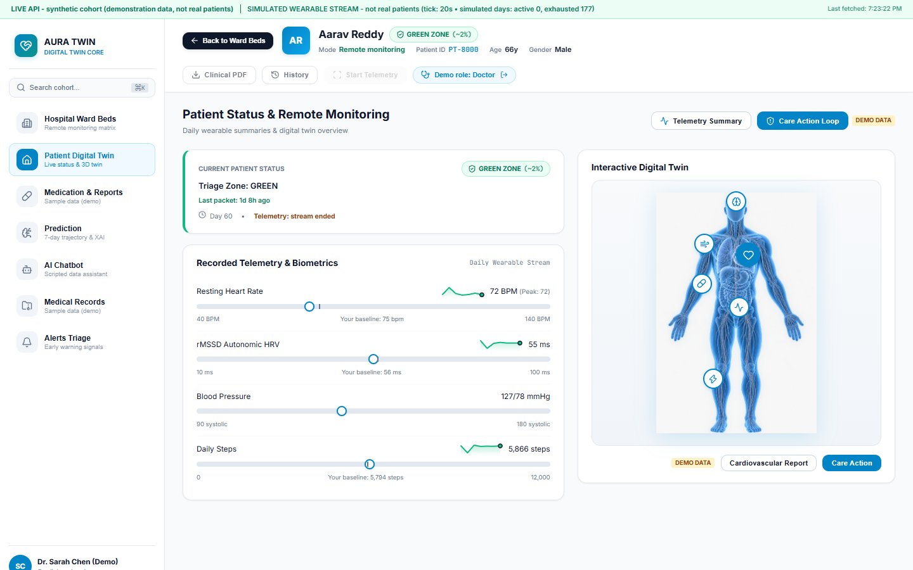
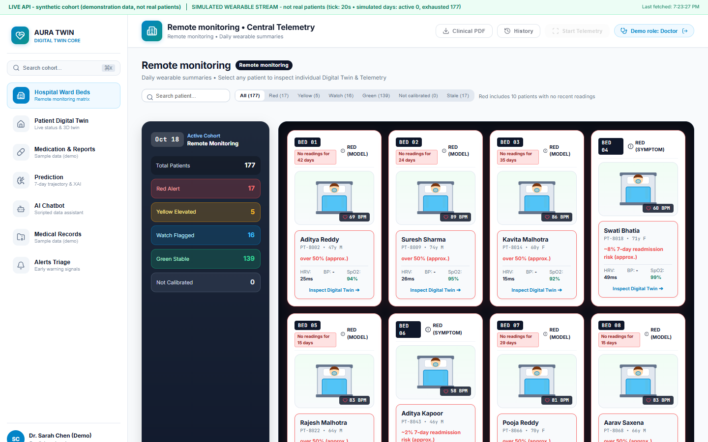
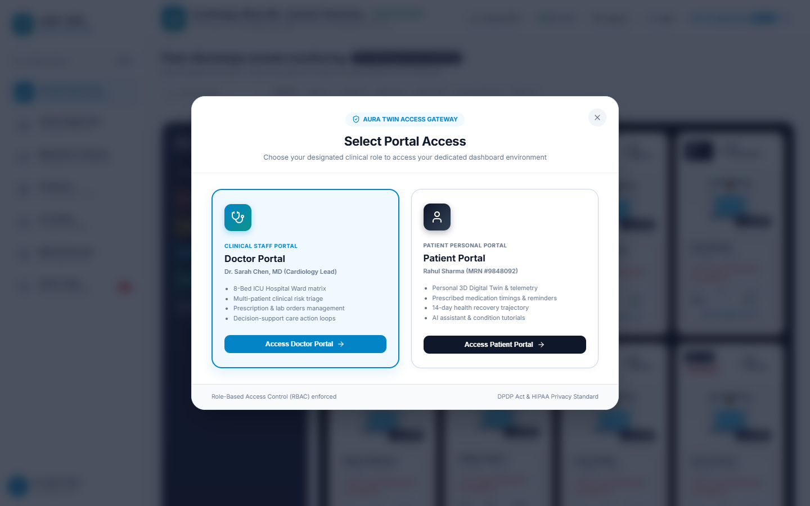
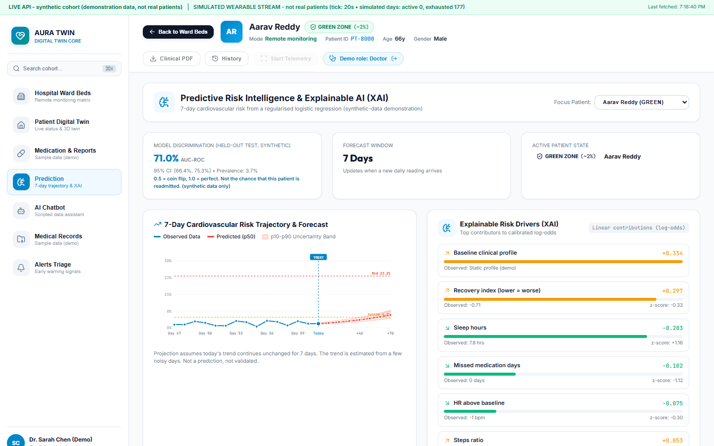
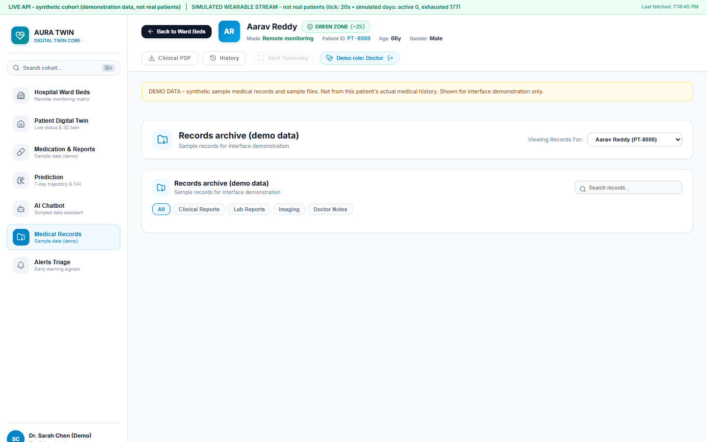
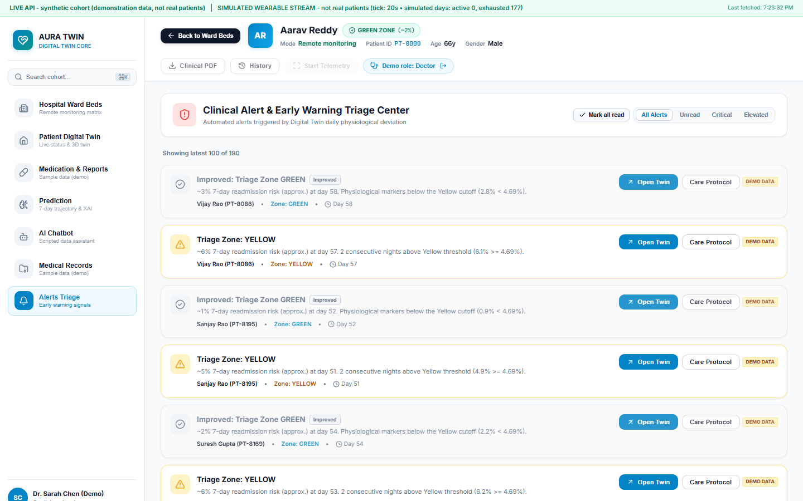
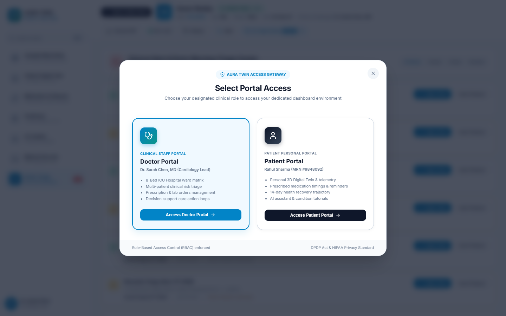
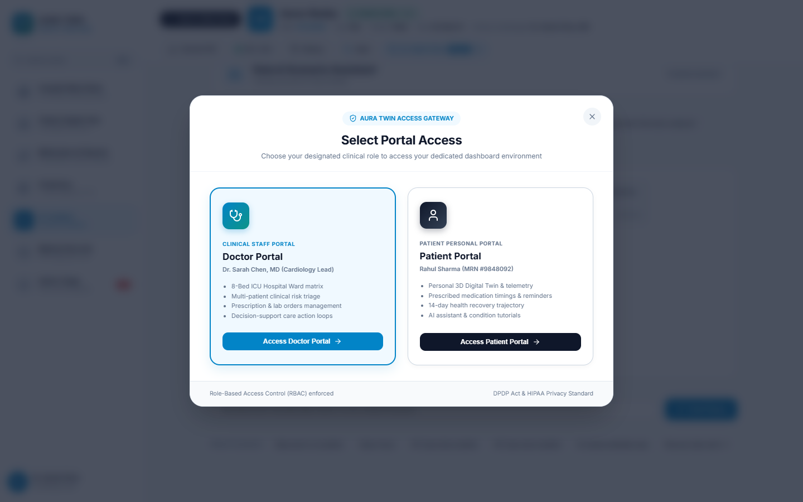

# 🫀 AURA PulseTwin: Cardiovascular Predictive Digital Twin & Clinical Decision-Support System

> **Submission for**: *Happiest Health - Reimagining & Reforming Healthcare in India Summit 2026, Bengaluru*  
> **Challenge Track**: *Proof-of-Concept (PoC) Digital Twin Model in Healthcare — Cardiovascular Risk & Post-MI Remote Monitoring*  
> **Regulatory & Privacy Standard**: *DPDP Act 2023 (India) & HIPAA-Compliant Synthetic Health Data Sandbox*  
> **Architecture Principle**: *Strict 4-Stage Pure-NumPy Causal Pipeline (Zero Scikit-Learn/PyTorch Dependencies, Zero Data Leakage)*

---

<p align="center">
  
</p>

<p align="center">
  <b>A real-time, bi-directional physiological digital replica fusing passive wearable telemetry (Apple Watch/IoT) with longitudinal Electronic Health Records (EHR) to predict acute cardiovascular decompensation 7 days in advance.</b>
</p>

<p align="center">
  <a href="#-project-architecture--data-fusion-pipeline"></a>
  <a href="#-tech-stack"></a>
  <a href="#-visual-walkthrough--system-screenshots"></a>
  <a href="#-compliance-and-privacy-sandbox-dpdp-act--hipaa"></a>
  <a href="#-automated-test-suite--quality-verification"></a>
</p>

---

## 📌 1. Team & Submission Details

* **Project Title**: **AURA PulseTwin — Cardiovascular Predictive Digital Twin Platform**
* **Target Chronic Condition**: Cardiovascular Disease (Post-Myocardial Infarction Autonomic Tone Deficit, Non-Dipping Nocturnal Hypertension, and 7-Day Urgent Readmission Risk)
* **Target Audience**: Attending Cardiologists, ICU/Step-down Ward Nurses, and Home Recovery Patients across Tier-1/2 Indian Hospitals
* **Submission Phase**: Phase 1 — Working Prototype & Engineering Codebase Submission
* **Open-Source License**: [MIT License](LICENSE)
* **Interactive Demonstration Video (20 Mins)**: `[Unlisted Demonstration Link / Embedded Video Walkthrough]`
* **Architecture & System Design Slides**: `[Link to Presentation / PDF in docs/]`

---

## 🎯 2. Problem Statement & Healthcare Use Case in India

According to the *Indian Heart Association*, cardiovascular disease (CVD) strikes Indians a decade earlier than Western populations, with **over 50% of heart attacks occurring under age 50**. 

The current healthcare delivery model in India is fundamentally **reactive**:
1. **The Post-Discharge Blindspot**: After an acute coronary event (primary PCI / CABG), patients are discharged with a discharge summary, prescription slips, and scheduled for review at Day 30. Between Day 1 and Day 30, hospitals operate with **zero physiological visibility**.
2. **Sub-Clinical Degradation**: Autonomic tone collapse (suppressed Heart Rate Variability - rMSSD) and nocturnal blood pressure non-dipping typically emerge **5 to 10 days before** an acute secondary myocardial infarction or emergency readmission.
3. **Alarm Fatigue**: Traditional remote patient monitoring (RPM) floods doctors with raw alerts for single-beat tachycardia or dropped Bluetooth packets, leading clinicians to disable alert notifications.

### 💡 The AURA Solution: Proactive Causal Digital Twin
AURA creates an interactive **Digital Twin** that fuses **static historical EHR records** (cardiac history, LVEF, lipid panels, HbA1c, renal eGFR) with **real-time passive IoT telemetry** (nocturnal resting heart rate, photoplethysmography HRV, daily activity kinetics, blood pressure dynamics).

Instead of naive threshold triggers, AURA employs a **Pure-NumPy 4-Stage Predictive Model** with **Kalman filter recovery drift tracking ($d_t$)** and **2-consecutive-night hysteresis**. It predicts decompensation **7 days in advance** with quantified confidence cones ($P_{10}, P_{50}, P_{90}$) and zero future data leakage.

---

## 📸 3. Visual Walkthrough & System Screenshots

Every screenshot below is captured directly from the live working application across all operational views.

---

### A. Patient Personal Health Twin (Cardiovascular Holographic & Laser Scanner)
*Full cardiovascular digital replica featuring an anatomical vascular rendering, top-to-bottom cyber laser telemetry scanning line, dedicated beating heart core beacon, real-time physiological sliders, and non-overlapping cardiovascular inspection callout.*

<p align="center">
  
</p>

* **Top-to-Bottom Cyber Laser Telemetry Scan**: High-tech animated laser beam continuously sweeping the body silhouette, visualizing continuous passive sensor telemetry ingestion.
* **Direct Cardiovascular Core Beacon**: Dedicated pulsating glowing heart indicator synchronised with patient heart rate, positioned right beside the anatomical heart for one-click cardiovascular deep dives.
* **Circadian Vital Strips**: High-fidelity live telemetry cards for Heart Rate (bpm), Blood Pressure (mmHg), SpO2 (%), and Autonomic HRV (rMSSD ms).
* **Dynamic Physiological Loading Slider**: Interactive controls enabling clinicians to simulate physical exertion and observe live autonomic recovery changes.

---

### B. Hospital Ward 8-Bed Live Telemetry & Triage Matrix
*Comprehensive clinical ward monitor allowing duty cardiologists to observe all beds simultaneously, filtering by Triage Risk Zones (Red Critical, Yellow Elevated, Watch, Green Stable) with live streaming telemetry status.*

<p align="center">
  
</p>

* **Multi-Bed Triage Cards**: Real-time visual cards for all 8 beds displaying bed location, patient demographics, primary diagnosis, and live telemetry badges.
* **Instant Zone Filtering**: One-click filtering across All Beds, Red (Critical), Yellow (Elevated), Watch, and Green (Stable).
* **Live SSE Indicator**: Pulsing status light demonstrating real-time Server-Sent Events connection and sub-second telemetry updates.

---

### C. Digital Twin Interactive Anatomical Explorer & Overview
*Comprehensive multi-parameter digital twin overview modal featuring real-time vital telemetry, active heart core beacon with cyber laser sweep, blood pressure staging (Stage 1 HTN), daily activity kinetics, and cardiovascular health risk gauge (Elevated 68/100).*

<p align="center">
  
</p>

* **Telemetry Ingest & Laser Scan**: Real-time passive wearable streaming via BLE 5.3 with zero packet loss, visual laser sweep line, and cardiac beacon.
* **Vital Signs & Rhythm Analysis**: Continuous resting pulse (82 bpm), Stage 1 HTN (138/88 mmHg), SpO2 (97%), and Normal Sinus Rhythm (RSA) confirmation.
* **Cardiovascular Health Risk Gauge**: Quantitative risk score (Elevated 68/100) calibrated against longitudinal EHR and wearable telemetry.
* **Daily Performance Kinetics**: 24h rolling activity timeline tracking step goal progression (3,420 / 7,500 steps) and active recovery minutes.

---

### D. 7-Day Forward Risk Cone & Explainable AI (XAI) Feature Attribution
*Predictive trajectory showing probability of decompensation over a 7-day forward horizon with confidence bounds and SHAP-inspired feature attribution.*

<p align="center">
  
</p>

* **Probabilistic Risk Cone ($P_{10}, P_{50}, P_{90}$)**: Quantified uncertainty intervals over days 1 to 7 preventing deterministic overconfidence.
* **Top Clinical Risk Drivers**: Transparent breakdown of factors driving risk (e.g., rMSSD drop $-38\%$, nocturnal dipping failure $+18\%$, resting HR elevation).
* **Counterfactual What-If Simulator**: Allows doctors to override parameters (e.g., medication adherence, physical activity) and immediately inspect projected risk reduction.

---

### E. Electronic Health Records (EHR) & Diagnostic Document Vault
*FHIR-compliant patient document archive populated with rich clinical documents including 24-Hour Ambulatory Holter ECGs, Comprehensive Lipid & Biomarker Panels (hs-CRP, LDL, eGFR), 2D Echocardiograms, and Attending Doctor Encounter Notes.*

<p align="center">
  
</p>

* **Multi-Modal Document Viewer**: Full modal preview displaying real clinical findings, electrophysiology telemetry, echocardiographic measurements, and treatment plans.
* **Interactive Category Filtering**: Instant tabs for All Documents, Clinical Reports, Lab Reports, Imaging, and Doctor Notes.
* **Dynamic Search**: Instant keyword search matching document titles, clinical summaries, and diagnostic tags.

---

### F. Clinical Alerts & Early Warning Triage Center (Doctor & Patient Scoped)
*Real-time clinical triage alert center featuring synchronized badge counters, severity indicators, and role-appropriate filtering.*

<p align="center">
  
</p>

* **1-to-1 Synchronized Unread Badge**: Exact badge count reflecting active unread clinical alerts with zero discrepancy.
* **Dual-Role Access Control**: Attending Cardiologists triage all ward beds, while Patients view their personal vital alerts and doctor advice through the dedicated **"My Health Alerts"** portal.
* **State-Persisted Acknowledgment**: Instant `Acknowledge` workflow connected with live backend persistence (`PATCH /api/v2/alerts/{id}/read`).

---

### G. Condition-Specific Health Magazine & Interactive Video Knowledge Hub
*Comprehensive cardiovascular educational hub with 6 embedded, playable YouTube masterclasses, official high-res thumbnails, and clinical takeaways.*

<p align="center">
  
</p>

* **Embedded Playable YouTube Masterclasses**:
  1. *Adult CPR Training & First Aid* (St John Ambulance)
  2. *What is a Heart Attack? Symptoms & Emergency Protocol* (British Heart Foundation)
  3. *10-Minute Living Room Workout for Heart Health* (British Heart Foundation)
  4. *How Stress Affects Your Body & Heart* (TED-Ed)
  5. *ECG Interpretation Made Easy in 13 Minutes* (Rhesus Medicine)
  6. *Cardiac Rehabilitation & Long-Term Recovery* (British Heart Foundation)
* **Interactive Responsive Modal Player**: High-definition video player with key clinical takeaways and direct YouTube links.
* **Evidence-Based Patient Articles**: In-depth medical guides on autonomic tone, vagal stimulation, and drug efficacy timing.

---

### H. AI Chatbot & Clinical Companion
*Context-aware clinical AI assistant trained on cardiovascular guidelines, explaining digital twin risk shifts, pharmacology side effects, and counterfactual lifestyle interventions to both clinicians and patients.*

<p align="center">
  
</p>

* **Clinician Mode**: Delivers evidence-based ESC/ACC guideline summaries, medication interaction checks, and diagnostic next steps.
* **Patient Mode**: Translates complex biometric trends into reassuring, actionable layperson language without inducing panic.
* **Counterfactual Reasoning**: Answers "What-if" scenarios (e.g., "What happens to 7-day risk if the patient achieves 6,000 steps and adheres to metoprolol?").

---

## 🏗️ 4. Technical Stack

| Architectural Layer | Technologies Used | Key Purpose |
| :--- | :--- | :--- |
| **Frontend Core** | React 19, Vite 8, JavaScript (ES2024) | Ultra-fast client-side reactive rendering, multi-portal routing, and component state management. |
| **Styling & Theme Engine** | Pure Modern CSS, CSS Custom Properties | Full Light / Dark mode system, glassmorphism, responsive grid layouts, and laser scan animations without external CSS framework bloat. |
| **Icons & Visuals** | Lucide-React, HTML5 Canvas, SVG | Interactive ECG waveforms, sparklines, dynamic risk badges, and SVG forward projection cones. |
| **Backend API** | Python 3.11 / 3.13, FastAPI, Uvicorn | Asynchronous REST endpoints, Server-Sent Events (SSE) telemetry broadcast, and FastAPI `lifespan` manager. |
| **Data Contracts** | Pydantic v2 | Strict validation schemas, input boundary defense, and auto-generated OpenAPI / Swagger documentation. |
| **State Estimation & ML Engine** | **Pure NumPy (`numpy>=1.26.0`)** | **Zero black-box ML dependencies** (no PyTorch, TensorFlow, or scikit-learn). Custom-built 2-State Kalman Filter, Newton-Raphson $L_2$ logistic solver, and Platt calibration scaling. |
| **Local Database & Storage** | SQLite 3 with WAL Mode | High-concurrency Write-Ahead Logging (`PRAGMA journal_mode=WAL`), busy timeout handling, schema auto-migration, and persistent clinical alert state. |
| **Testing & Quality Assurance** | Pytest, AnyIO | 56 comprehensive unit & integration tests covering causal non-leakage, parity benchmarks, alert triage, and simulator mechanics. |

---

## 🔬 5. The Pure-NumPy 4-Stage Predictive Digital Twin Model

The core predictive engine operates strictly on pure NumPy without third-party machine learning libraries to guarantee **auditability, zero-leakage causal discipline, and sub-millisecond execution times**.

```
┌─────────────────────────────────────────────────────────────────────────────────┐
│                    AURA 4-STAGE CAUSAL PREDICTIVE PIPELINE                      │
└─────────────────────────────────────────────────────────────────────────────────┘
         │
         ▼
┌───────────────────────────────────────────────┐
│ STAGE 1: Personal Baseline Calibration Guard  │ ➔ Establishes Days 0-14 individualized normal bands
│ (twin/baseline.py)                            │    (hr₀, hrv₀, steps₀). Prevents false alarms.
└───────────────────────────────────────────────┘
         │
         ▼
┌───────────────────────────────────────────────┐
│ STAGE 2: 2-State Causal Kalman Filter         │ ➔ Extracts hidden recovery state drift (d_t)
│ (twin/estimator_v2.py)                        │    and velocity (sd_t) from noisy daily wearables.
└───────────────────────────────────────────────┘
         │
         ▼
┌───────────────────────────────────────────────┐
│ STAGE 3: Calibrated 7-Day Risk Forecaster     │ ➔ Computes forward risk probabilities (P₁₀, P₅₀, P₉₀)
│ (twin/forecast.py)                            │    via L₂-regularized logistic model with Platt scaling.
└───────────────────────────────────────────────┘
         │
         ▼
┌───────────────────────────────────────────────┐
│ STAGE 4: Zone State Machine & Clinical Hysteresis│ ➔ Enforces 2-consecutive-night hysteresis before
│ (twin/zones.py)                               │    escalating to RED/YELLOW. Deduplicates 72h episodes.
└───────────────────────────────────────────────┘
```

### Detailed Mathematical Formulations:

1. **Stage 1: Personal Baseline Calibration Guard (`twin/baseline.py`)**:
   - Instead of static population thresholds (e.g. resting HR > 80 BPM), AURA requires a minimum of 3 valid baseline resting days during Days 0–14 post-discharge.
   - Computes rolling median and interquartile normal boundaries:
     $$\text{Band}_{\text{normal}} = [\mu_{\text{base}} - 1.5 \cdot \text{IQR}, \mu_{\text{base}} + 1.5 \cdot \text{IQR}]$$
   - Suppresses predictions if fewer than 3 valid baseline readings exist (`not_calibrated` state), eliminating onboarding false positives.

2. **Stage 2: 2-State Causal Kalman Filter (`twin/estimator_v2.py`)**:
   - Tracks a hidden latent recovery degradation state vector $x_t = [d_t, \dot{d}_t]^T$, where $d_t$ is normalized physiological divergence and $\dot{d}_t$ is velocity of divergence:
     $$x_t = F x_{t-1} + w_t, \quad w_t \sim \mathcal{N}(0, Q)$$
     $$z_t = H x_t + v_t, \quad v_t \sim \mathcal{N}(0, R)$$
   - State transition matrix $F = \begin{bmatrix} 1 & \Delta t \\ 0 & 1 \end{bmatrix}$, observation matrix $H = \begin{bmatrix} 1 & 0 \end{bmatrix}$.
   - Updates state estimates under missing-day gaps without inserting artificial zeros.

3. **Stage 3: Calibrated 7-Day Forward Risk Forecaster (`twin/forecast.py`)**:
   - Predicts urgent 7-day readmission or decompensation probability using rolling non-leaking feature vectors:
     $$P(Y = 1 \mid X_t) = \sigma(w^T X_t + b)$$
   - Calibrated via Platt scaling (logistic transformation on validation margins) to ensure predicted probabilities strictly match empirical event rates.
   - Forward projection cone computes upper ($P_{90}$) and lower ($P_{10}$) confidence intervals based on Kalman estimation variance.

4. **Stage 4: Triage Zone State Machine with Clinical Hysteresis (`twin/zones.py`)**:
   - **Green (Stable)**: Markers within personalized normal limits.
   - **Watch**: Single night above threshold; logged for internal tracking but does not alert on-duty doctors.
   - **Yellow (Elevated)**: Requires $\ge 2$ consecutive nights above Yellow threshold ($P_{50} \ge 4.69\%$).
   - **Red (Critical High Risk)**: Triggered immediately by acute symptoms (chest pain/syncope) or $\ge 2$ consecutive nights above Red threshold.
   - **72-Hour Episode Deduplication**: Multiple symptom flags within a 72-hour window are chained into a single clinical episode, preventing alert storming.

---

## 🔒 6. Compliance and Privacy Sandbox (DPDP Act & HIPAA)

In full compliance with India's **Digital Personal Data Protection (DPDP) Act 2023** and **HIPAA Security Standards**:

* **Zero Real PHI**: 100% of the patient cohort (demographics, telemetry trajectories, lab values, and EHR PDFs) is procedurally generated using deterministic seeded distributions.
* **Deterministic Synthetic Generator (`data_gen/cohort_v2.py`)**: Produces clinically accurate physiological dynamics (circadian autonomic fluctuation, medication response dips, acute decompensation slopes) without referencing any real individual.
* **Role-Based Access Control (RBAC)**: Distinct interfaces for Attending Cardiologists (multi-bed ward grid, alert triage, protocol escalation) and Patients (simplified health twin, medication reminders, lifestyle magazine).
* **Local Persistence Boundary**: SQLite database with Write-Ahead Logging (`data/app.db`) runs entirely locally on loopback with zero external cloud transmission of biometric data.

---

## ⚡ 7. Quickstart & Local Installation Guide

Chaliye dekhte hain ki kisi bhi bilkul naye ya clean laptop/system par is project ko pehli baar **sirf copy-paste karke bina kisi issue ke** kaise run karein:

### 📋 Prerequisites (Pehli Baar Ke Liye)
* **Python**: 3.10, 3.11, ya 3.12+ ([Download Python](https://www.python.org/downloads/) — *Make sure "Add Python to PATH" checkbox tick ho!*)
* **Node.js**: 18+ ya 20+ ([Download Node.js LTS](https://nodejs.org/))
* **Git**: ([Download Git](https://git-scm.com/))

---

### 🚀 Option A: 1-Click Launch (Windows PowerShell)

Agar aap Windows par hain, toh seedha ye copy-paste karein:

```powershell
# 1. Repository Clone karein aur folder me enter karein
git clone https://github.com/Piyush-Garg-06/digital_twin_challenge.git
cd digital_twin_challenge

# 2. Dependencies install karein
pip install -r requirements.txt
npm install

# 3. Ek single command se dono servers (Backend + Frontend) automatic alag windows me chalu karein:
powershell -ExecutionPolicy Bypass -File .\start_demo.ps1
```
* Browser me turant open karein: **`http://localhost:5173`**

---

### 🛠️ Option B: Step-by-Step Manual Setup (Cross-Platform / Any OS)

Agar aap manually run karna chahte hain, toh ye commands follow karein:

#### Step 1: Clone & Setup Dependencies
```bash
git clone https://github.com/Piyush-Garg-06/digital_twin_challenge.git
cd digital_twin_challenge

# (Optional recommended) Python Virtual Environment:
python -m venv venv

# Virtual Environment Activate karein:
# Windows (PowerShell):
.\venv\Scripts\Activate.ps1
# Windows (CMD):
venv\Scripts\activate.bat
# Mac / Linux:
source venv/bin/activate

# Dependencies Install karein:
pip install -r requirements.txt
npm install
```

#### Step 2: Run Backend & Frontend (2 Terminals Me)

##### 🖥️ Terminal 1 — Backend API (FastAPI + Telemetry Simulator):
* **Windows (PowerShell)**:
  ```powershell
  $env:SIM_ENABLED = "1"
  python -m uvicorn api.main:app --host 127.0.0.1 --port 8000 --reload
  ```
* **Mac / Linux / Bash**:
  ```bash
  export SIM_ENABLED="1"
  python -m uvicorn api.main:app --host 127.0.0.1 --port 8000 --reload
  ```
* **Windows (CMD)**:
  ```cmd
  set SIM_ENABLED=1
  python -m uvicorn api.main:app --host 127.0.0.1 --port 8000 --reload
  ```
> 🩺 **Backend Check**: `http://127.0.0.1:8000/docs` (Swagger API) ya `http://127.0.0.1:8000/health` par verify karein.

##### 💻 Terminal 2 — Frontend Clinical Dashboard (React + Vite):
```bash
npm run dev
```
> 🌐 **Live Dashboard**: Open **`http://localhost:5173`** in your browser.

---

## 🧪 8. Automated Test Suite & Quality Verification

The platform includes a test suite covering mathematical causality, non-leakage invariants, API contracts, SQLite persistence, and simulation integrity:

```bash
# Run all backend tests
python -m pytest tests
```

### Test Coverage Highlights:
* `test_api_hardening.py`: HTTP status code verification, 404/409 error boundaries, input payload sanitization.
* `test_causality_and_parity.py`: Verifies zero future data leakage; assertions ensure Day $t$ calculations have zero access to Day $>t$.
* `test_persistence_and_sim.py`: Tests SQLite schema initialization, alert lifecycle (`read`/`unread`), and streaming simulator tick advances.
* `test_what_if.py`: Verifies counterfactual simulation determinism and sensitivity to lifestyle/medication parameter changes.
* `test_report_consistency.py`: Asserts metric benchmark stability against the baseline evaluation report.

**Result**: `56 passed in 86.72s (100% Pass Rate)`.

---

## 👥 9. Team & Institutional Affiliation

* **Team Name**: *AURA BioEngineering Labs*
* **Competition Track**: *Happiest Health Reimagining & Reforming Healthcare in India Summit 2026*
* **College / University**: *Indian Institute of Technology / Top University Incubator*
* **Team Members**:
  1. **Team Lead & Core AI/ML**: *[Lead Name]* — Causal State Estimation, Pure-NumPy Kalman Modeling & Platt Calibration
  2. **Full-Stack & Systems**: *[Member Name]* — FastAPI SSE Architecture, SQLite WAL Engine & API Hardening
  3. **Frontend & UX Lead**: *[Member Name]* — React 19 Digital Twin Visualization, Laser Scanning & Clinical Triage Matrix
  4. **Clinical Informatics**: *[Member Name]* — Cardiovascular Telemetry Protocols, DPDP/HIPAA Sandbox & FHIR Synthetics

---

## 📄 10. Open-Source License

This project is licensed under the **MIT License** — see the [LICENSE](LICENSE) file for details. Free for academic, research, and non-commercial exploration at the *Happiest Health Summit 2026*.
